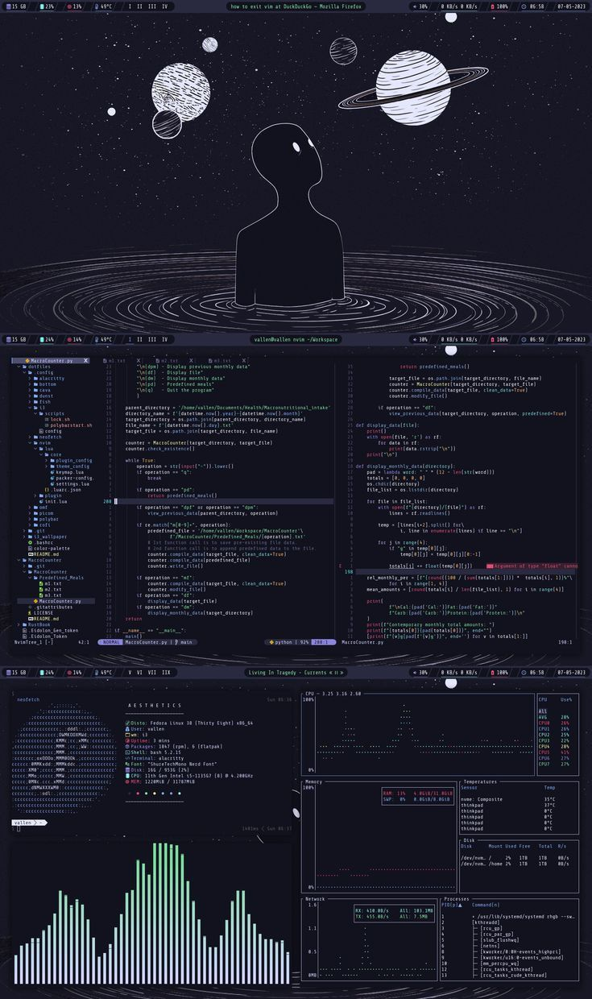

<p align="center">
  
</p>
<p align="center">
  <a href="https://github.com/tanushpatel-git"></a>
</p>

```json
{
  "profile": {
    "name": "Tanush Patel",
    "username": "tanushpatel-git",
    "role": "Full Stack · Data Science · Generative AI Developer",
    "location": "India",
    "portfolio": "https://tanushportfolioo.netlify.app",
    "github": "https://github.com/tanushpatel-git"
  },
  "focus": [
    "Full Stack Web Development",
    "Data Science & Analytics",
    "Generative AI / LLM Applications"
  ],
  "skills": {
    "languages": ["JavaScript", "TypeScript", "Python", "Java", "C++", "SQL", "Go"],
    "frontend": ["React", "Next.js", "Tailwind CSS", "HTML5", "CSS3"],
    "backend": ["Node.js", "Express", "FastAPI", "REST APIs"],
    "dataScience": ["Pandas", "NumPy", "scikit-learn", "Matplotlib", "Jupyter", "tensorFlow", "PyTorch"],
    "genAI": ["LLMs", "Prompt Engineering", "LangChain", "RAG", "OpenAI API", "LangGraph"],
    "tools": ["Git", "GitHub", "Docker", "VS Code", "Postman", "Kubernet"]
  },
  "projects": {
    "Bytebin": {
      "tagline": "A GitHub fallback that fills GitHub's gaps and gives developers a better environment to grow",
      "status": "In development",
      "role": "Founder & Developer"
    }
  },
  "currently": {
    "status": "Freelancing",
    "workingOn": "Bytebin — a GitHub fallback that fills GitHub's gaps and gives developers a better environment to grow",
    "learning": "Advanced Generative AI & MLOps",
    "openTo": ["Freelance projects", "Collaboration"]
  },
  "interests": ["Open Source", "Developer Tools", "Hackathons", "Problem Solving", "Chess"]
}
```
